# 明朝中央机构修正思维导图

- 日期：2026-08-09
- 适用范围：明代中后期北京中央机构功能分类
- 图示性质：制度关系示意图，不代表所有机构在同一年以相同强度运行
- 总体置信度：高
- 内容基线：[《明朝机构结构图内容基线》](./明朝机构结构图内容基线_2026-08-09.md)

## 图例

- 实线：正式政务、裁决、执行或文书传递关系。
- 虚线：监督、制衡、协调、规谏或非固定关系。
- 内阁不是六部的法定上级。
- 三公三孤、太子三师三少在明代中后期多为荣衔、兼官或加官，不构成稳定行政层级。

## 修正后的中央机构图

```mermaid
flowchart TB
    EMP["皇帝<br/>最高决策与最终裁断"]

    CAB["内阁<br/>顾问・票拟・起草诏敕<br/>不是六部的法定上级"]
    SLI["司礼监<br/>掌章奏・批红・传旨<br/>权力强弱随时期变化"]

    EMP -->|"命其议拟"| CAB
    CAB -->|"票拟意见"| EMP
    EMP -->|"御批或授权批红"| SLI

    TONG["通政使司<br/>接收・审验・汇进章奏"]
    TONG -->|"章奏入口"| EMP

    subgraph EXEC["外廷行政系统"]
        direction LR
        LI["吏部<br/>文官选授・考核"]
        HU["户部<br/>户籍・田赋・财政"]
        LI2["礼部<br/>礼仪・祭祀・科举・外交"]
        BING["兵部<br/>军政・武官选授・征调"]
        XING["刑部<br/>刑名・案件初审"]
        GONG["工部<br/>工程・营造・水利"]
    end

    EMP -->|"裁定政务"| EXEC
    SLI -->|"传达批红政令"| EXEC
    CAB -.->|"协调、拟议；非正式统辖"| EXEC

    subgraph SUP["监察与封驳系统"]
        direction LR
        DU["都察院<br/>纠劾百官・巡按地方<br/>统辖十三道监察御史"]
        KE["六科<br/>规谏・封驳・稽察六部<br/>注销政务"]
    end

    KE -.->|"逐部稽察、封还执奏"| EXEC
    DU -.->|"监察、纠劾"| EXEC
    KE -.->|"规谏、奏驳"| EMP
    DU -.->|"奏劾"| EMP

    subgraph MIL["军事系统：军权分置"]
        direction LR
        WUFU["五军都督府<br/>中・左・右・前・后<br/>军籍・卫所军政"]
        COMMAND["临战统帅<br/>皇帝临时命将<br/>并非常设总司令"]
    end

    BING -->|"征调、军令"| COMMAND
    WUFU -->|"提供卫所兵员"| COMMAND
    EMP -->|"任命与节制"| COMMAND
    BING -.->|"军政制衡"| WUFU

    subgraph JUSTICE["三法司司法系统"]
        direction LR
        JX["刑部<br/>审判"]
        JD["都察院<br/>监督、会审"]
        DALI["大理寺<br/>复核、平反"]
        JX -->|"会审"| JD
        JD -->|"复核案件"| DALI
    end

    EMP -->|"重大案件裁决"| JUSTICE

    subgraph PROF["专业、礼仪与文教机构"]
        direction LR
        TEMPLES["五寺<br/>大理・太常・光禄・太仆・鸿胪<br/>只是合称，不是统一机关"]
        HANLIN["翰林院<br/>制诰・修史・讲读"]
        GUOZI["国子监<br/>最高官学"]
        QINTIAN["钦天监<br/>天文・历法"]
        TAIYI["太医院<br/>国家与宫廷医疗"]
        SHANGBAO["尚宝司<br/>符玺・印信"]
    end

    EMP --> PROF
    LI2 -.->|"礼制业务联系"| TEMPLES

    subgraph CAPITAL["京师治理与皇帝侍卫"]
        direction LR
        JINYI["锦衣卫<br/>侍卫・侦缉<br/>北镇抚司专理诏狱"]
        WUCHENG["五城兵马司<br/>京城巡捕・街道・火禁<br/>不是中央决策机关"]
    end

    EMP --> JINYI
    DU -.->|"巡城监察"| WUCHENG

    subgraph PALACE["内廷宦官机构"]
        direction TB
        TWELVE["十二监<br/>司礼・内官・御用・司设・御马・神宫<br/>尚膳・尚宝・印绶・直殿・尚衣・都知"]
        FOUR["四司<br/>惜薪・钟鼓・宝钞・混堂"]
        EIGHT["八局<br/>兵仗・银作・浣衣・巾帽<br/>针工・内织染・酒醋面・司苑"]
        TWELVE --- FOUR
        FOUR --- EIGHT
    end

    EMP --> PALACE
    SLI --- TWELVE

    subgraph ROYAL["皇族与东宫系统"]
        direction LR
        ZONG["宗人府<br/>宗室属籍・封爵・婚丧<br/>后期多项实务转礼部"]
        ZHAN["詹事府・左右春坊・司经局<br/>太子辅导・讲读・东宫文书"]
        PRINCE["太子三师、三少<br/>明中后期多为兼官、加官或虚衔"]
    end

    EMP --> ZONG
    EMP --> ZHAN
    PRINCE -.->|"名义辅导；通常非实职"| ZHAN

    HONOR["三公、三孤<br/>太师・太傅・太保<br/>少师・少傅・少保<br/>中后期主要是荣衔、加官、赠官"]
    HONOR -.->|"不构成常设行政层级"| EMP

    classDef emperor fill:#8b1e1e,color:#fff,stroke:#5c1010,stroke-width:3px;
    classDef core fill:#d89b2b,color:#201507,stroke:#9d6c16,stroke-width:2px;
    classDef executive fill:#315f8c,color:#fff,stroke:#1d4265;
    classDef supervise fill:#7b4f91,color:#fff,stroke:#50305f;
    classDef military fill:#536b3f,color:#fff,stroke:#36462a;
    classDef specialist fill:#397c78,color:#fff,stroke:#255653;
    classDef palace fill:#9b4b57,color:#fff,stroke:#6e3039;
    classDef royal fill:#806733,color:#fff,stroke:#584720;
    classDef honor fill:#e6dfcf,color:#332b20,stroke:#897b62,stroke-dasharray:5 5;

    class EMP emperor;
    class CAB,SLI,TONG core;
    class LI,HU,LI2,BING,XING,GONG executive;
    class DU,KE,JX,JD,DALI supervise;
    class WUFU,COMMAND military;
    class TEMPLES,HANLIN,GUOZI,QINTIAN,TAIYI,SHANGBAO,JINYI,WUCHENG specialist;
    class TWELVE,FOUR,EIGHT palace;
    class ZONG,ZHAN,PRINCE royal;
    class HONOR honor;
```

## 核心政务链

> 通政使司汇进章奏 → 皇帝裁决或命内阁票拟 → 内阁提交票拟 → 皇帝亲批或司礼监批红 → 六部及有关衙门执行；六科负责封驳稽察，都察院负责监察纠劾。
